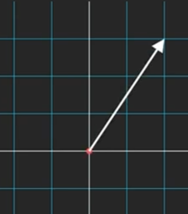

public:: true
filters:: {"templates" false}
type:: 
alias::
tags:: LLM, ML

- # Basic entities
- ## [[Scalars]]
    - Basically numbers, can be added subtracted etc. They are called as such because they help "scale up" or "scale down" other entities.
- ## [[Vectors]]
    - Vectors are basically lists of numbers.
    - If these are two numbers, we can visualize it on 2D plane. Drawn from the `(0,0)`and their tip pointing at the point specified by the numbers in the list. Meaning, they have direction and magnitude.
        - $$
          \vec{V} = [2, 3]
          $$
            - 
            -
    -
- ## [[Matrices]]
    - A Matrix is a rectangular array of numbers. (2D)
    - $$
      M = \underset{2 \times 3}{\begin{bmatrix} 0 & 4 & 5 \\ 6 & 0 & 8 \end{bmatrix}}
      $$
    - They are useful because they can help represent images, tabular data, and are helpful in operations involving vectors and matrices.
- ## [[Tensors]]
    - Generalized form of N-dimensional Array
    - If a Matrix is a 2D Tensor, then a 3D Tensor can be visualized as a cube of numbers, any higher dimension is hard to visualize for humans.
    - A color image can be represented as a Tensor (a matrix for R, G and B each)
- # Simple operations with Scalars, Vectors and Matrices
- Scalars are simple numbers.
    - ```python
      a = 2
      b = 3
      
      sum = a + b
      difference = a - b
      multiplication = a*b
      division = a/b
      power = a**b
      ```
- Vectors:
    - Element wise Addition Subtraction
        - $$
          \vec{V}_1 = \begin{bmatrix} 2 \\ 1 \end{bmatrix} \quad \vec{V}_2 = \begin{bmatrix} 1 \\ 3 \end{bmatrix} \\[10pt]
          \vec{V}_1 + \vec{V}_2 =  \begin{bmatrix} 2 \\ 1 \end{bmatrix} +  \begin{bmatrix} 1 \\ 3 \end{bmatrix} =  \begin{bmatrix} 2 + 1 \\ 1+ 3 \end{bmatrix} =  \begin{bmatrix} 3 \\ 4 \end{bmatrix}
          $$
        - ```python
          # basic way
          a = [1, 2, 3]
          b = [4, 5, 6]
          
          def add_vectors(a, b):
            assert len(a) == len(b)
            result = []
            for i, j in zip(a, b):
              result.append(i+j) # subtraction will have - instead of +
            return result
          
          # numpy
          import numpy as np
          a = np.array([1, 2, 3])
          b = np.array([4, 5, 6])
          sum = a + b
          difference = a - b
          
          ```
    - Multiplying by scalar
      collapsed:: true
        - $$
          \vec{V} = \begin{bmatrix} 2 \\ 3 \end{bmatrix} \quad k = 3 \\[10pt]
          k \cdot \vec{V} = 3 \cdot \begin{bmatrix} 2 \\ 3 \end{bmatrix} = \begin{bmatrix} 3 \cdot 2 \\ 3 \cdot 3 \end{bmatrix} = \begin{bmatrix} 6 \\ 9 \end{bmatrix}
          $$
        - ```python
          # basic way
          a = [1, 2, 3]
          def scale_vector(a, scalar):
            result = []
            for element in a:
              result.append(element*scalar)
            return result
          
          # numpy
          import numpy as np
          a = np.array([1, 2, 3])
          scalar = 2
          scaled_vector = a*scalar
          
          ```
    - L2 Norm of vector (Also called Magnitude or Euclidean Magnitude)
        - $$
          \vec{V} = \begin{bmatrix} 2 \\ 3 \end{bmatrix} \\[10pt]
          \|\vec{V}\| = \sqrt{2^2 + 3^2} = \sqrt{4 + 9} = \sqrt{13}
          $$
        - ```python
          # basic way
          import math
          
          a = [1, 2, 3]
          
          def vector_norm(a):
            result = 0
            for element in a:
              result += element**2  # square
            return math.sqrt(result)
          
          # numpy
          import numpy as np
          np.linalg.norm(a)
          ```
    - Dot Product
      collapsed:: true
        - Used extensively in [[ML]]
        - $$
          \vec{a} = \begin{bmatrix} 2 & 3 & 4 \end{bmatrix} \quad \vec{b} = \begin{bmatrix} 1 & 5 & -2 \end{bmatrix} \\[10pt]
          \vec{a} \cdot \vec{b} = 2 \cdot 1 \; + \; 3 \cdot 5 \; + \; 4 \cdot -2 \\[10pt] = 2 + 15 - 8 \\[10pt] = 9
          $$
        - ```python
          # basic way
          a = [1, 2, 3]
          b = [4, 5, 6]
          
          def dot_product(a, b):
          	result = 0
              for i, j in zip(a, b):
              	result += i, j
              return result
              
          # numpy
          import numpy as np
          
          a = np.array([1, 2, 3])
          b = np.array([4, 5, 6])
          dot_product = a.dot(b)
          ```
        - the dot product is the cosine value of the angle between two vectors if both vectors have magnitude equal to 1
            - ```python
              import numpy as np
              vector_1 = np.array([2, 0])
              vector_2 = np.array([-2, 0])
              
              vector_1_magnitude = np.linalg.norm(vector_1)
              vector_2_magnitude = np.linalg.norm(vector_2)
              """
              >>> vector_1_magnitude
              np.float64(2.0)
              >>> vector_2_magnitude
              np.float64(2.0)
              """
              
              vector_1_normalized = vector_1 / vector_1_magnitude
              vector_2_normalized = vector_2 / vector_2_magnitude
              """
              >>> vector_1_normalized
              array([1., 0.])
              >>> vector_2_normalized
              array([-1.,  0.])
              """
              
              dot_product = vector_1_normalized.dot(vector_2_normalized) # will be same as:
              cosine_of_180_degrees = np.cos(np.pi) # 180 degrees = pi radians
              """
              >>> dot_product
              np.float64(-1.0)
              >>> cosine_of_180_degrees
              np.float64(-1.0)
              """
              ```
    - [[Euclidean Distance]]
        - The straight-line distance between two points in space. In machine learning and neural networks, it is commonly used to measure similarity (or dissimilarity) between data points, calculate loss functions (like Mean Squared Error), and evaluate how far a model's prediction is from the actual target. for 2D vectors, it's same as pythagorean theorem
        - $$
          \begin{aligned}
          &\vec{V}_1 = \begin{bmatrix} 2 \\ 1 \end{bmatrix} \quad \vec{V}_2 = \begin{bmatrix} 5 \\ 5 \end{bmatrix} \\[10pt]
          &\|\vec{V}_1 - \vec{V}_2\| = \sqrt{(2 - 5)^2 + (1 - 5)^2} = \sqrt{(-3)^2 + (-4)^2} = \sqrt{9 + 16} = \sqrt{25} = 5
          \end{aligned}
          $$
        - ```python
          # basic way
          import math
          
          a = [2, 1]
          b = [5, 5]
          
          def euclidean_distance(v1, v2):
              assert len(v1) == len(v2)
              squared_sum = 0
              for i, j in zip(v1, v2):
                  squared_sum += (i - j) ** 2
              return math.sqrt(squared_sum)
          
          dist_basic = euclidean_distance(a, b)
          
          # numpy
          import numpy as np
          a = np.array([2, 1])
          b = np.array([5, 5])
          
          # numpy.linalg.norm automatically calculates the L2 (Euclidean) distance
          dist_numpy = np.linalg.norm(a - b)
          ```
    - [[Cosine Similarity]]
        - Cosine of the angle between the vectors #definition
        - Is a similarity measure that is widely used in [[ML]],
            - In [[NLP]] it is used to compare similarity in text
            - In Image processing, it is used in comparing, for example human faces in two images,
        - Cosine similarity is a metric that measures the cosine of the angle between two non-zero vectors. In machine learning and neural networks, it is widely used to measure how similar two items are regardless of their magnitude, making it essential for text analysis (like document similarity), recommendation systems, and comparing embeddings (vector representations of words or images).
        - $$
          \vec{A} = \begin{bmatrix} 2 \\ 3 \end{bmatrix} \quad \vec{B} = \begin{bmatrix} 4 \\ 1 \end{bmatrix} \\[10pt]
           \cos(\theta) = \frac{\vec{A} \cdot \vec{B}}{\|\vec{A}\| \|\vec{B}\|} \\[10pt]
          = \frac{(2 \times 4) + (3 \times 1)}{\sqrt{2^2 + 3^2} \times \sqrt{4^2 + 1^2}} \\[10pt]
          = \frac{8 + 3}{\sqrt{13} \times \sqrt{17}} = \frac{11}{\sqrt{221}} \approx 0.740
          $$
        - ```python
          # basic way
          import math
          
          a = [2, 3]
          b = [4, 1]
          
          def cosine_similarity(v1, v2):
              assert len(v1) == len(v2)
              dot_product = sum(i * j for i, j in zip(v1, v2))
              magnitude_v1 = math.sqrt(sum(i**2 for i in v1))
              magnitude_v2 = math.sqrt(sum(j**2 for j in v2))
              return dot_product / (magnitude_v1 * magnitude_v2)
          
          sim_basic = cosine_similarity(a, b)
          
          # numpy
          import numpy as np
          a = np.array([2, 3])
          b = np.array([4, 1])
          
          # dot product divided by the product of the L2 norms
          sim_numpy = np.dot(a, b) / (np.linalg.norm(a) * np.linalg.norm(b))
          ```
- Matrices
    - Matrix Addition/Subtraction
        - $$
          A = \begin{bmatrix} 2 & 1 \\ 3& -1 \end{bmatrix} \quad B = \begin{bmatrix} 1 & -2 \\ 0 & 4 \end{bmatrix} \\[10pt]
          A + B = \begin{bmatrix} 2 & 1 \\ 3 & -1 \end{bmatrix} + \begin{bmatrix} 1 & -2 \\ 0 & 4 \end{bmatrix} = \begin{bmatrix} 2+1 & 1+-2 \\ 3+0 & -1+4 \end{bmatrix} = \begin{bmatrix} 3 & -1 \\ 3 & 3 \end{bmatrix}
          $$
        - ```python
          # basic
          matrix1 = [[1,2,3], [4,5,6]]
          matrix2 = [[7,8,9], [10,11,12]]
          
          def matrix_addition(matrix1, matrix2):
            if len(matrix1) != len(matrix2) or len(matrix1[0]) != len(matrix2[0]):
              raise ValueError("Matrices must have same dimensions")
              
            result = [[0 for _ in range(len(matrix1[0]))] for _ in range(len(matrix1))]
            
            for i in range(len(matrix1)):
              for j in range(len(matrix1[0])):
                result[i][j] = matrix1[i][j] + matrix2[i][j]  # for subtraction - instead of +
            return result
          
          # numpy
          matrix1 = np.array([[1,2,3], [4,5,6]])
          matrix2 = np.array([[7,8,9], [10,11,12]])
          
          matrix_sum = matrix1 + matrix2
          matrix_diff = matrix1 - matrix2
          ```
    - Multiply Matrix by Scalar
        - $$
          A = \begin{bmatrix} 2 & 1 \\ 3 & -1 \end{bmatrix} \quad k = 2 \\[10pt]
          kA = 2 \cdot \begin{bmatrix} 2 & 1 \\ 3 & -1 \end{bmatrix} = \begin{bmatrix} 2 \cdot 2 & 2 \cdot 1 \\ 2 \cdot 3 & 2 \cdot -1 \end{bmatrix} = \begin{bmatrix} 4 & 2 \\ 6 & -2 \end{bmatrix} 
          $$
        - ```python
          # basic way 
          matrix1 = [[1,2,3], [4,5,6]]
          
          def matrix_scalar_multiplication(matrix1, scalar):
            result = [[0 for _ in range(len(matrix1[0]))] for _ in range(len(matrix1))]
            for i in range(len(matrix1)):
              for j in range(len(matrix1[0])):
                result[i][j] = scalar * matrix[i][j]
            return result
          
          
          # numpy
          matrix = np.array([[1,2,3], [4,5,6]])
          scaled_matrix = 2*matrix
          ```
    - Matrix Transpose
        - $$
          M = \begin{bmatrix}3 & 8 & 2 \\
          6 & 0 & 0
          \end{bmatrix} \\[10pt]
          M^T = \begin{bmatrix}
          3 & 6 \\
          8 & 0 \\
          2 & 0
          \end{bmatrix}
          $$
        - ```python
          # basic way
          def transpose_matrix(matrix):
            rows = len(matrix)
            cols = len(matrix[0])
            transposed = [[0 for _ in range(rows)] for _ in range(cols)]
            
            for i in range(rows):
              for j in range(cols):
                transposed[j][i] = matrix[i][j]
                
            return transposed
          
          # numpy
          import numpy as np
          matrix = np.array([[1,2,3], [4,5,6]])
          transposed_matrix = matrix.T
          ```
    - Matrix Multiplication
        - **Super Important** in [[ML]] because weights and inputs of [[Neural Networks]] are represented as matrices or tensors. And a lot of Matrix Multiplication are performed during Inference and training processes.
        - Number of rows in the first matrix must be equal to the number of columns in the second matrix.
        - $$
          A = \begin{bmatrix} 1 & 2 & 3 & 4 \\ 4 & 3 & 2 & 1 \\  1 & 2 & 3 & 4 \end{bmatrix} \quad
          B = \begin{bmatrix} 1 & 2 \\ 3 & 4 \\ 5 & 6 \\ 7 & 8 \end{bmatrix} \\[10pt]
          
          A \cdot B = \begin{bmatrix} R_1 \cdot C_1 & R_1 \cdot C_2 \\ R_2 \cdot C_1 & R_2 \cdot C_2 \\ R_3 \cdot C_1 & R_3 \cdot C_2 \end{bmatrix} \\[10pt]
          =  \begin{bmatrix} 50 & 60 \\ 30 & 40 \\ 50 & 60 \end{bmatrix}
          $$
            - Dot product of the `R1 = [1 2 3 4]` of `A` with `C1 = [1 3 5 7]`  of `B`. Rows are all from `A` and columns are all from `B`. So the result matrix will have number of rows same as `A` and number of columns same as `B`
        - ```python
          # basic way is a bit time consuming and I am on a tight schedule. Some other day
          # numpy
          import numpy as np
          
          matrix1 = np.array([[1,2,3], [4,5,6]])
          matrix2 = np.array([[7,8], [9,10], [11,12]])
          
          result = matrix1.dot(matrix2)
          # or
          result = np.matmul(matrix1, matrix2)
          ```